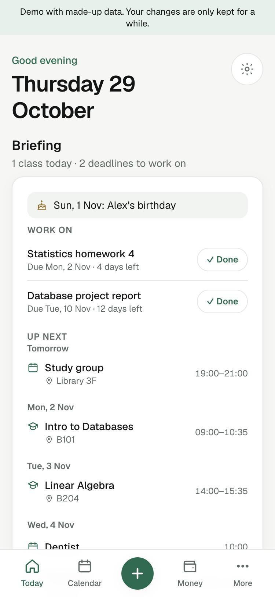
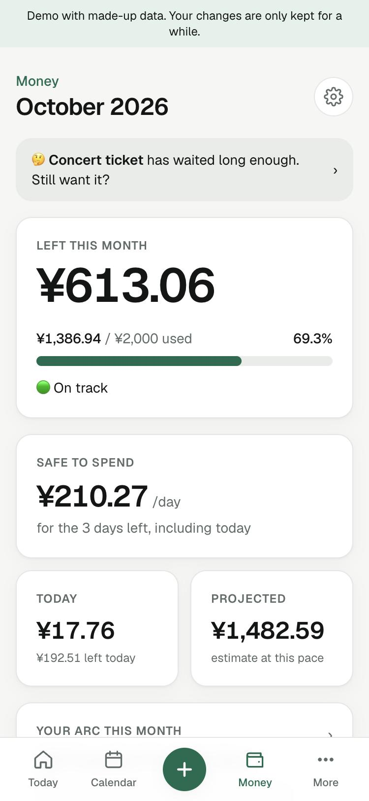
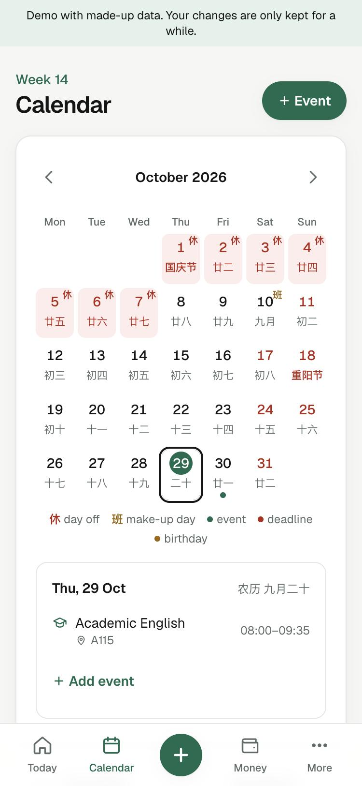
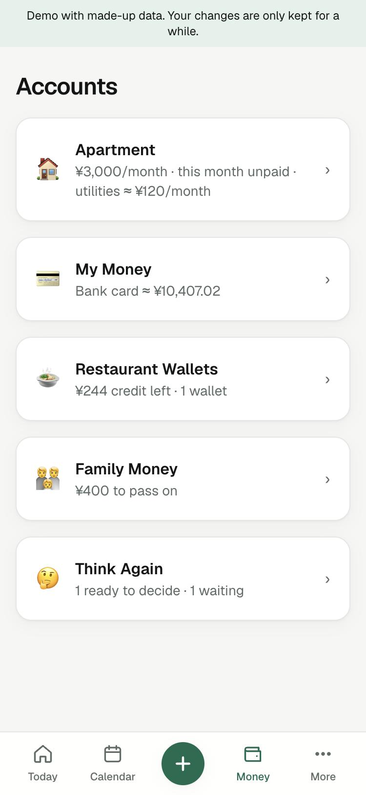
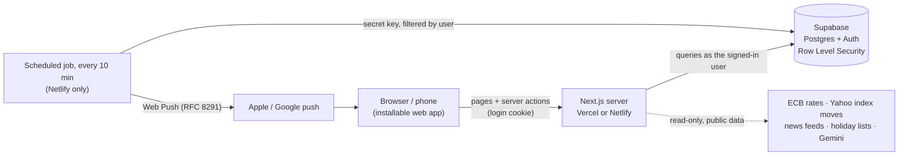
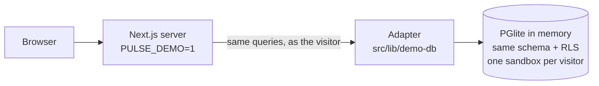

# Pulse

Your day, money and plans in one private place. Pulse is a web app that works like a phone app, built for students and workers in **Mainland China or Hong Kong**. It covers classes and holidays, deadlines and birthdays, a morning briefing, and a budget that keeps every account separate so the numbers never mix.

**Try it:** run it in demo mode with one command, no database or accounts needed ([below](#try-it-in-demo-mode)). Every visitor gets their own copy of made-up data.

> I build Pulse with AI coding agents (Claude Code and Codex) and review every change before it's merged.

<p>
  
  
  
  
</p>

*Screenshots from demo mode; all data is made up.*

---

## What's inside

**Today**
- A morning **briefing** with your classes, deadlines to work on, events, birthdays, holidays, goals and market moves. It can also arrive as a push notification.
- **Today's plan**: write your day freely and it becomes a tick-off list.
- **Up next**, pinned **notices**, a **markets & news** card and your **progress** (money and goals).

**Calendar**
- Month view with lunar dates, festivals and official holidays: Mainland China (with 调休 make-up days) or Hong Kong.
- **Timetable**: semesters with weekly classes in their teaching weeks. Add classes one by one, paste a whole timetable as text, or read it from a photo (optional, Gemini).
- Events, multi-day events, **deadlines** that remind you 1–2 weeks ahead, and **birthdays**.

**Money** (in your home currency: ¥ RMB or HK$ HKD)

| Account | What it is | Counts toward your monthly budget? |
|---|---|---|
| **Personal** | Everyday spending in 8 categories, in any currency (converted at a rate you can see) | ✅ Yes, this *is* the budget |
| **Savings Box** | What's left of each month's budget when you close the month | No |
| **Apartment** (optional) | Rent, plus electricity and water bills | No |
| **Restaurant wallets** | Prepaid credit. The **top-up cash** counts once as Food; eating from the credit doesn't | Only the top-up cash |
| **Family Money** (optional) | Money someone sends you to pass on (all of it, or part, with the rest yours), and loans to them, per person | No, never |
| **My Money** | Real balances in your bank, Alipay, WeChat… Each moves with what you pay from it and the money you move between them | No |
| **Think Again** | A waitlist for things you want; nothing counts until you buy | Only when bought |

Also: spending history charts, a spending calendar, monthly "Wrapped" recaps, a spending "arc" (Monk → Frugal → Balanced → Hedon → Chaos), JSON backups and CSV export. Plus **Goals** (money, habits, number targets, milestones), a **Notices** board that finds dates in pasted group messages (中文 and English), and **News** (headlines by topic, index moves, exchange rates).

---

## How it works



**Demo mode** swaps only the database: the same server code talks to real Postgres running *inside* the app (PGlite, Postgres compiled to WebAssembly), loaded with the same schema and made-up data.



- **The browser never talks to Supabase.** Every read and write goes through the app's server code with your login cookie, so the database's Row Level Security applies to everything. From China, that also means your phone only needs to reach one website.
- **The database enforces the rules, not just the app.** Every table is owner-only, the Savings Box and restaurant credit can't go below zero, closing a month is all-or-nothing, and a restore either fully succeeds or changes nothing.
- **Money is exact.** Every amount is stored as whole cents (fen) of your home currency (¥12.34 = 1234), never as a float. A foreign expense keeps its original amount and the rate used.
- **Each account sets itself up once.** The welcome screen asks where you live (Mainland → ¥ and mainland holidays; Hong Kong → HK$ and HK holidays), your monthly budget and which extras you use.
- **Logic lives in pure, tested functions** (`src/lib/*.ts`); pages stay thin.

**Stack:** Next.js 16 (App Router, TypeScript) · Tailwind CSS 4 · Supabase (`@supabase/ssr`) · Zod · Vitest. No UI kit and no AI SDK: Web Push encryption and the Gemini call are plain `fetch` + Node crypto.

---

## Try it in demo mode

You need **Node.js 22.12+**. No database, Docker or accounts.

```bash
git clone https://github.com/Vetame21/pulse-public.git && cd pulse-public
npm install
PULSE_DEMO=1 npm run dev     # http://localhost:3000 → Try the demo
```

**What demo mode is:**
- **Real Postgres, in memory.** It runs inside the app with the same schema, Row Level Security and database rules as production.
- **A sandbox per visitor.** "Try the demo" creates your own copy of about three months of made-up data, so you never see anyone else's changes.
- **Nothing is kept.** Sandboxes are cleared after 12 hours, and everything restarts fresh with the server.
- **Some things are off:** sign-up, AI photo reading, restoring backups and push notifications.

**How it works:** [`src/lib/demo-db/`](src/lib/demo-db) answers the same `supabase.from(…).select().eq(…)` calls the app makes in production. It runs them as SQL, as the signed-in visitor, so Row Level Security filters every row. The made-up data comes from [`supabase/demo/seed.sql`](supabase/demo/seed.sql).

## Run it on a hosted Supabase project

1. **Create a Supabase project.** In **SQL Editor**, paste and run [`supabase/migrations/0001_schema.sql`](supabase/migrations/0001_schema.sql).
2. **Auth settings:** under **Authentication → URL Configuration**, add `http://localhost:3000/**` to the redirect URLs.
3. **Configure and start:**
   ```bash
   npm install
   cp .env.example .env.local   # fill in SUPABASE_URL and SUPABASE_PUBLISHABLE_KEY
   npm run dev                  # http://localhost:3000
   ```
4. **Check that the database is private** (signed-out visitors can't read anything):
   ```bash
   npm run check:security       # prints "All tables are private."
   ```

### Optional extras

All of these are in [`.env.example`](.env.example):
- **Push notifications:** a VAPID key pair, plus the Supabase secret key for the scheduled job.
- **Timetable photos:** a Gemini API key. AI calls are capped per account per day.

## Deploy

- **A public demo on Vercel (free Hobby plan):** import the repo and set one environment variable, `PULSE_DEMO=1`. Each server instance keeps its own in-memory database, so a visitor's edits may disappear early if Vercel moves them to a fresh instance (they get new demo data and carry on).
- **Vercel with Supabase:** add the Supabase variables instead. Push notifications stay off there, because the scheduled job is a Netlify function.
- **Netlify:** build settings come from [`netlify.toml`](netlify.toml). The notification job in [`netlify/functions/notify.mts`](netlify/functions/notify.mts) runs every 10 minutes.

## Development

```bash
npm test               # Vitest: money maths, dates, budget, calendar, push crypto, parsers…
npm run typecheck
npm run lint
npm run build
```

| Folder | What's in it |
|---|---|
| `src/lib/*.ts` | Pure, tested logic: money, currency, dates, budget, calendar, timetable, goals, notices, briefing… |
| `src/lib/data/` | Server-only database access |
| `src/lib/push/`, `src/lib/news/`, `src/lib/ai/` | Notifications, news & markets, Gemini |
| `src/app/(app)/` | Pages; each folder's `actions.ts` holds its server actions |
| `supabase/migrations/` | The database schema, RLS policies and rules |
| `supabase/demo/` | The made-up demo data (`reset_demo`) |
| `src/lib/demo-db/` | Demo mode: in-memory Postgres and the adapter that answers Supabase-style queries |

Rules for contributors (people and coding agents) are in [AGENTS.md](AGENTS.md).

## Security notes

- **Two sign-in checks:** every page except sign-in/sign-up needs a session, checked in `src/proxy.ts` and again before any data is read.
- **Owner-only access is enforced by the database** (Row Level Security), so it holds even if the website code has a bug.
- **Sign-in lockout:** too many wrong passwords pause sign-in for 15 minutes. Attempts are stored only as SHA-256 fingerprints.
- **The session cookie is locked down:** HttpOnly, Secure, SameSite=Lax. Pages are sent with `noindex` and never cached.

## License

[MIT](LICENSE)
